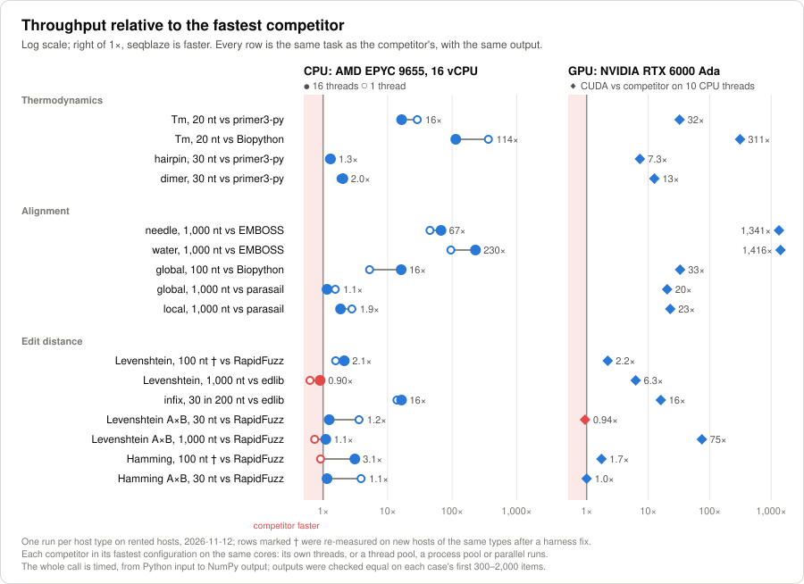

# seqblaze

[](https://pypi.org/project/seqblaze/)
[](https://pypi.org/project/seqblaze/)
[](#install)
[](#license)

**Fast, exact batch computation on DNA sequences for Python: edit distance, alignment, melting temperature and hybridization thermodynamics, on multicore CPUs and NVIDIA GPUs.**

seqblaze takes whole lists of sequences (Python lists, NumPy, Arrow, FASTA/FASTQ files or GPU arrays) and computes over the pairs you ask for, from zipped pairs to all pairs within a list or A × B, in one call. A Rust core runs SIMD kernels on every CPU core, or CUDA kernels on the GPU, and the results come back as columns. They are identical to the last bit on any thread count, on the CPU and on the GPU. The name stands for *Bit-exact, Lane-parallel, Accelerated, Zero-overhead Engine*, where zero-overhead means no per-item overhead.

```bash
pip install seqblaze
```

```python
import seqblaze as sb

primers = ["AGCTGACCTGAAGCTTGCAT", "TTGCATGCAAGCTTCAGGTC", "CGTACGTTAGCCATGGATCC",
           "GGATCCATGGCTAACGTACG", "ATATATATCGCGCGTATATA"]
cond = sb.Conditions(temp_c=37.0, na_mM=50.0, oligo_nM=250.0)

# Melting temperature of every primer (nearest-neighbour model, explicit conditions).
print(sb.tm(primers, cond=cond).tm_c.round(1))             # [56.2 55.7 54.5 54.5 44.9]

# Tm as primer3-py 2.3.1 computes it (compatibility preset), for the whole list at once.
print(sb.tm(primers, compat="primer3").tm_c.round(1))      # [60.  59.4 58.2 58.2 48.4]

# Every pair of primers, each primer with itself included: keep duplexes at or below -10 kcal/mol.
r = sb.duplex(sb.pairs.within(primers, self_pairs=True), cond=cond, keep=sb.keep.hits(cutoff=-10.0))
print(r.i, r.j, r.dg_kcal)                                 # [0 2] [1 3] [-15.01 -18.7 ]
```

Add `device="cuda"` to a call to run it on the GPU; the result is the same, byte for byte.

## Highlights

- **Whole batches in one call.** Five pair shapes (zipped pairs, index pairs, all pairs within a list, A × B, one against many) and output modes that never build an N × N matrix unless you ask for one: the hits under a cutoff, the top k per row, the best per row, or streamed tiles.
- **Fast on the CPU, faster on the GPU.** Multithreaded SIMD kernels (AVX2, AVX-512) and CUDA kernels for every primitive. In the benchmark runs of 2026-11-12, seqblaze was faster than the fastest competitor configuration in 22 of 23 cases at 16 threads on an AVX-512 CPU (19 of 23 at 10 threads on an AVX2 CPU), and on an RTX 6000 Ada it ran thermodynamics and alignment 7–1,416× faster than the fastest competitor on the host's CPU. [The numbers, including the cases where seqblaze is slower](#performance).
- **One answer everywhere.** Integer and fixed-order arithmetic make results bit-identical across thread counts, between CPU and GPU, and across GPU architectures.
- **The numbers of tools you already use.** Compatibility presets reproduce primer3-py 2.3.1 (Tm, hairpins, dimers, 3′ end stability), Biopython 1.88 `Tm_NN` and EMBOSS 6.6.0 `needle` and `water`, including which result they report among equal optima and how they round.
- **Complete results.** Every tie and every optimal end position is reported. Cutoffs and top-k are explicit parameters; nothing is dropped silently.
- **Thermodynamics with a paper trail.** Nearest-neighbour Tm and duplex free energies (the minimum free energy, or the ensemble free energy from the partition function with an error bound), over the SantaLucia & Hicks 2004 or the NNDB 2024 DNA parameters, each value traced to its source. `r.cite()` lists the papers behind any call.
- **Arrays in, columns out.** Python lists, NumPy, Arrow, pandas, polars and FASTA/FASTQ files (plain, gzip or BGZF) on the host, with NumPy and Arrow read without copying; CuPy, cuDF and DLPack arrays stay on the GPU. Results export to NumPy, Arrow, Parquet, pandas, polars, CuPy or cuDF.

## Status

Research preview, version 0.1.0. The API may still change. seqblaze is for research use only, and every result says so. The compatibility presets are checked against golden vectors produced by the reference tools, but the formal parity certificates planned for a certified release have not been produced yet. The test suite, golden vectors and development tooling are not part of this repository or of the packages. Tested on Linux x86_64 with CPython 3.12; see [Known limitations](#known-limitations). Bug reports, questions and suggestions are welcome as [GitHub issues](https://github.com/astding/seqblaze/issues).

## Performance



These are the ratios of one run of the benchmark suite on rented machines (2026-11-12). Each competitor ran in its fastest configuration on the same cores: its own threads where it has them, otherwise a thread pool, a process pool or parallel runs. The timing covers the whole call, from Python input to NumPy output. Where the task is the same, the output was checked equal to the competitor's on the first 300–2,000 items. Ratios above 1 mean seqblaze is faster; absolute throughput depends on the machine. Rows marked † were measured again on new hosts of the same types after a fix to the benchmark harness. The harness is part of the development tooling and is not in this preview.

**CPU** (AMD EPYC 9655, 16 vCPU, AVX-512): seqblaze at T threads divided by the fastest competitor configuration that uses at most T threads.

| Task | Fastest competitor | 1 thread | 8 threads | 16 threads |
|---|---|---|---|---|
| `levenshtein` global, 30 / 100 nt † | RapidFuzz `cpdist` | 2.02 / 1.56 | 2.59 / 1.68 | 2.93 / 2.13 |
| `levenshtein` global, 1,000 nt | edlib, process pool | **0.63** | **0.67** | **0.90** |
| `levenshtein` prefix / infix, 30 in 200 nt | edlib, process pool | 12.5 / 14.0 | 12.4 / 10.8 | 16.1 / 16.4 |
| `levenshtein` A × B, 30 / 100 nt | RapidFuzz `cdist` | 3.60 / 1.50 | 1.75 / 1.55 | 1.24 / 1.55 |
| `levenshtein` A × B, 1,000 nt | RapidFuzz `cdist` | **0.74** | 1.06 | 1.10 |
| `hamming`, 100 nt † | RapidFuzz `cpdist` | **0.91** | 2.70 | 3.10 |
| `hamming` A × B, 30 / 100 nt | RapidFuzz `cdist` | 3.88 / 3.38 | 1.39 / 1.28 | 1.15 / 1.07 |
| `align` global / local, 1,000 nt | parasail, thread pool | 1.54 / 2.79 | 1.24 / 1.86 | 1.15 / 1.86 |
| `align` global / local, 100 nt | Biopython `PairwiseAligner`, process pool | 5.25 / 6.16 | 16.5 / 24.5 | 16.2 / 34.3 |
| `compat="emboss-water"` / `"emboss-needle"`, 100–1,000 nt | EMBOSS 6.6.0, parallel runs | 96–143 / 45–106 | 101–133 / 45–73 | 129–230 / 67–93 |
| `tm(compat="primer3")` / `tm(compat="biopython")`, 20 nt | primer3-py / Biopython, process pool | 28.8 / 365 | 13.3 / 143 | 16.5 / 114 |
| `hairpin` / `duplex`, `compat="primer3"`, 30 nt | primer3-py, process pool | 1.25 / 1.89 | 1.25 / 1.83 | 1.30 / 2.02 |
| `duplex` MFE 25 / 60 nt, PF 25 nt *(different model)* | ViennaRNA, process pool | 3.10 / 2.88 / 7.12 | 2.90 / 2.81 / 7.10 | 3.20 / 3.20 / 9.11 |

**Where seqblaze is slower.** `levenshtein` global at 1,000 nt trails edlib at every thread count. On one thread, `levenshtein` A × B at 1,000 nt trails RapidFuzz, and `hamming` at 100 nt trails RapidFuzz `cpdist`. On a 10-core AVX2 CPU (the GPU host's AMD EPYC 7443, 10 threads), four cases trail: `levenshtein` A × B at 30 nt (0.64), `align` global and local at 1,000 nt against parasail (0.70 and 0.94) and `levenshtein` global at 1,000 nt (0.92). On one thread there, `levenshtein` global and A × B at 1,000 nt (0.74 and 0.77), `align` global at 1,000 nt (0.96) and `hamming` at 100 nt (0.89 †) trail. Part of the CPU margin comes from the AVX-512 code paths. The ViennaRNA row compares throughput only: ViennaRNA computes a different energy model, and no other tool computes seqblaze's native duplex model.

**GPU** (NVIDIA RTX 6000 Ada with a 10-vCPU AMD EPYC 7443): CUDA throughput divided by seqblaze's own CPU backend at 10 threads, and by the fastest competitor at up to 10 threads. In every case the CUDA path returned the CPU path's bytes on the checked items.

| Task | CUDA ÷ seqblaze CPU | CUDA ÷ fastest competitor |
|---|---|---|
| `duplex` MFE 25 / 60 nt | 91 / 246 | 311 / 837 (ViennaRNA, different model) |
| `duplex` PF 25 nt | 48 | 455 (ViennaRNA, different model) |
| `hairpin` / `duplex`, `compat="primer3"`, 30 nt | 5.4 / 5.5 | 7.3 / 12.6 |
| `align` global / local, 1,000 nt | 28.9 / 24.3 | 20.3 / 22.8 (parasail) |
| `align` global / local, 100 nt | 3.0 / 2.7 | 33 / 50 |
| EMBOSS presets, 1,000 / 100 nt | 16.9–19.7 / 2.6–2.9 | 1,341–1,416 / 237–277 |
| `levenshtein` A × B, 1,000 / 100 / 30 nt | 66 / 37 / 1.48 | 75 / 55 / **0.94** (RapidFuzz) |
| `levenshtein` global, 1,000 / 100 † / 30 † nt | 6.8 / 1.25 / **0.71** | 6.3 / 2.2 / 1.7 |
| `levenshtein` prefix / infix, 30 in 200 nt | 1.31 / 1.29 | 14.8 / 16.1 (edlib) |
| `hamming` 100 nt † / A × B 100 nt / A × B 30 nt | **0.71** / 1.11 / **0.93** | 1.7 / 1.5 / 1.0 (RapidFuzz) |
| `tm` native / primer3 / Biopython, 20 nt | 2.3 / 2.2 / 3.0 | 32 (primer3-py, different model) / 32 / 311 |

The GPU pays off for compute-heavy work: thermodynamics, alignment, and `levenshtein` on long sequences or A × B at 100 nt and longer. For light kernels on short sequences, moving the data costs about as much as computing it; see [CPU or CUDA](#cpu-or-cuda).

## What ships

| Kernel | Computes | Models and presets | CPU | CUDA |
|---|---|---|---|---|
| `sb.hamming` | Hamming distance | | yes | yes |
| `sb.levenshtein` | Unit-cost edit distance in `mode="global"`, `"prefix"` or `"infix"`, with optional CIGAR and every optimal end position | | yes | yes |
| `sb.align` | Affine-gap alignment (Gotoh): score, coordinates, CIGAR, aligned strings, identity statistics | native `mode="local"` / `"global"`; `compat="emboss-water"`, `"emboss-needle"` | yes | yes |
| `sb.tm` | Two-state melting temperature, ΔG, ΔH and ΔS of a sequence with its complement, or of two given strands in register | native `params="santalucia2004"` or `"nndb2024-dna"`; `compat="primer3"`, `"biopython"` | yes | yes |
| `sb.hairpin` | primer3 hairpin thermodynamics | `compat="primer3"` (needs [`seqblaze[primer3]`](#the-primer3-extra)) | yes | yes |
| `sb.duplex` | Intermolecular hybridization: minimum free energy, or ensemble free energy from the partition function | native `model="mfe"` and `model="pf"` with `params="santalucia2004"` or `"nndb2024-dna"`; `compat="primer3"` (needs [`seqblaze[primer3]`](#the-primer3-extra)) | yes | yes |

Readers: `sb.read_fasta`, `sb.read_fastq`, `sb.iter_fasta` and `sb.iter_fastq` read plain, gzip or BGZF files into a `SeqBatch`, which every kernel takes without copying.

Introspection: `sb.kernels()`; `sb.describe("duplex")` (fields, presets, backends, papers); `sb.presets(kind)` with kind `"compat"`, `"params"`, `"conditions"` or `"scoring"`; `sb.build_info()`. Both native parameter presets are available for unary and paired `tm` and for `duplex` MFE/PF on CPU and CUDA; `sb.presets("params")` gives the scope and caveats of each.

## Install

```bash
pip install seqblaze
```

On Linux x86_64 (glibc 2.28 or newer) with Python 3.10 or newer, pip installs the binary wheel. It holds the CPU backend and the CUDA backend, built with nvcc 12.8 for the `release` architecture set (machine code for sm_75, sm_80, sm_86, sm_89, sm_90, sm_100 and sm_120, plus compute_120 PTX). Without an NVIDIA GPU or driver everything runs on the CPU, and an explicit `device="cuda"` raises `sb.DeviceError`. The GPU path needs a driver that supports CUDA 12.8 (see [Known limitations](#known-limitations)).

On any other platform pip builds the source distribution, which needs the Rust toolchain (see below). Only Linux x86_64 has been tested.

## Install from source

Requirements:
- Linux x86_64 (the only platform tested so far);
- Python 3.10 or newer (tested with CPython 3.12) and `pip`;
- the Rust toolchain pinned by `rust-toolchain.toml`. With [rustup](https://rustup.rs) installed, the pinned version is selected automatically;
- for the CUDA backend, a CUDA toolkit whose `nvcc` is release 12.8 or 12.9 (see below).

The only runtime dependency is NumPy (1.26 or newer).

[THIRD-PARTY-NOTICES](https://github.com/astding/seqblaze/blob/main/THIRD-PARTY-NOTICES) covers all production components, including the **optional** CUDA support; this does not mean CUDA is enabled in a particular build. Source installs keep that acknowledgement set, and the binary wheel, which has CUDA enabled, carries the same file.

From the top of a source checkout:

```bash
python3 -m venv .venv
. .venv/bin/activate
pip install .            # CPU build, optimized (maturin release profile)
python -c "import seqblaze as sb; print(sb.__version__, sb.build_info()['cuda_compiled'])"
```

### CUDA build

The CUDA backend is a compile-time feature. The build looks for `nvcc` in `SEQBLAZE_NVCC` (an absolute path), then `$CUDA_HOME/bin/nvcc`, then `PATH`, and refuses any release other than 12.8 or 12.9. The default build targets sm_120 (compute capability 12.0 machine code plus compute_120 PTX), with fused multiply-add, flush-to-zero and fast math switched off. `SEQBLAZE_CUDA_ARCHS=release` adds machine code for sm_75, sm_80, sm_86, sm_89, sm_90 and sm_100. The full GPU test suite has run on sm_120 and, with a `release` build, on sm_89. At run time only the GPU driver library (`libcuda`) is needed, loaded dynamically; no CUDA runtime library is required.

```bash
export SEQBLAZE_NVCC=/path/to/cuda/bin/nvcc     # or set CUDA_HOME, or put nvcc on PATH
MATURIN_PEP517_ARGS="--features cuda" pip install .
python -c "import seqblaze as sb; print(sb.build_info()['cuda_compiled'])"   # True
```

### The primer3 extra

`hairpin(compat="primer3")` and `duplex(compat="primer3")` evaluate primer3's thermodynamic model over primer3-py 2.3.1's own parameter files. seqblaze neither ships nor imports primer3-py. At run time it locates the installed distribution's data files and checks their SHA-256. Install them with the extra:

```bash
pip install "seqblaze[primer3]"   # from PyPI; adds primer3-py==2.3.1
pip install ".[primer3]"          # from a source checkout
```

Without the extra, those two presets raise `ParameterError` with this install hint. `tm(compat="primer3")` does not need it.

### Optional interop packages

None of these is required. Each one enables its own inputs or exports.

| Package | Enables |
|---|---|
| pyarrow | Arrow arrays and chunked arrays as inputs; `Result.to_arrow()`, `Result.to_parquet(path)` |
| pandas, polars | Series as inputs; `Result.to_pandas()`, `Result.to_polars()` |
| CuPy | GPU arrays (`__cuda_array_interface__`, DLPack) as inputs, `stream=`, `Result.to_cupy()` |
| cuDF | string columns on the GPU as inputs; `Result.to_cudf()` |

## Using seqblaze

Every kernel takes a pair space or a list of sequences, computes, and keeps what you ask for. The examples run as written on a CPU build, except where the first line says otherwise.

### Edit distance

```python
import seqblaze as sb

seqs = ["ACGTACGT", "ACGTACGA", "TTTTACGT", "ACGAACGT"]

# All pairs within a list (upper triangle), keeping pairs at distance <= 1.
r = sb.levenshtein(sb.pairs.within(seqs), keep=sb.keep.hits(cutoff=1))
print(r.to_numpy())    # {'dist': [1, 1], 'i': [0, 0], 'j': [1, 3]}

# Zipped pairs: one value per pair, in input order.
print(sb.hamming(sb.pairs.zip(["ACGTACGT", "TTTT"], ["ACGTTCGA", "TTTA"])).dist)   # [2 1]

# Find a short query inside longer sequences (infix mode), with every optimal end.
r = sb.levenshtein(sb.pairs.one_to_many("ACGT", ["TTACGTTT", "GGGG"]), mode="infix",
                   fields=["dist", "b_start", "b_end", "n_ends", "cigar"])
print(r.dist, r.b_start, r.b_end)    # [0 3] [2 0] [6 1]
```

`hamming`, `levenshtein`, and `align` with `match`/`mismatch` scoring accept upper-case `ACGT` by default. With `check_bases=False` they compute over the raw bytes of any alphabet (case-sensitive) and issue `sb.IllegalBaseWarning` when an input contains a byte other than `ACGT`.

### Alignment

```python
import seqblaze as sb

pairs = sb.pairs.zip(["ACGTTGCAAGTC"], ["ACGTGCAAGTCC"])

# Global alignment as EMBOSS 6.6.0.0 needle reports it (EDNAFULL, gap open 10, extend 0.5).
r = sb.align(pairs, compat="emboss-needle", fields=["score", "cigar", "aligned_a", "aligned_b"])
print(r.score, r.aligned_a[0], r.aligned_b[0])   # [45.] ACGTTGCAAGTC- ACG-TGCAAGTCC

# Native local alignment with your own scoring.
scoring = sb.Scoring(match=2, mismatch=-3, gap_open=5, gap_extend=2)
r = sb.align(pairs, mode="local", scoring=scoring, fields=["score", "a_start", "a_end", "cigar"])
print(r.score, r.cigar[0])                       # [17.] 4=1I7=
```

### Melting temperature

Native thermodynamics needs explicit conditions; there are no hidden defaults.

```python
import seqblaze as sb

cond = sb.Conditions(temp_c=37.0, na_mM=50.0, oligo_nM=250.0)
r = sb.tm(["ACGTACGTTGCA", "GCGCGCATATGCGC"], cond=cond, fields="all")
print(r.tm_c, r.dg_kcal)        # [39.64118395 54.36869826] [-11.02 -16.57]

# Two given strands in register (a 5'->3' against b 3'->5'), mismatches allowed.
a = ["ACGTACGTTGCA", "ACGTACGTTGCA"]
b = ["TGCAACGTACGT", "TGCAACCTACGT"]
print(sb.tm(sb.pairs.zip(a, b), cond=cond).tm_c)              # [39.64118395 17.94062366]

# Compatibility presets carry their own conditions.
print(sb.tm(["ACGTACGTTGCAAGT"], compat="primer3").tm_c)     # [49.46851553]
print(sb.tm(["ACGTACGTTGCAAGT"], compat="biopython").tm_c)   # [44.08279605]
```

### Hybridization

```python
import seqblaze as sb

cond = sb.Conditions(temp_c=37.0, na_mM=50.0, oligo_nM=250.0)
probes = ["ACGTTGCAAGTCCGTA", "TTGACGGATCCAGTCA", "GGCATCGATCGTTAGC"]
targets = ["TACGGACTTGCAACGT", "TGACTGGATCCGTCAA", "GCTAACGATCGATGCC", "AAAAAAAAAAAAAAAA"]

# Every probe against every target: the best target per probe by minimum free energy.
r = sb.duplex(sb.pairs.cross(probes, targets), cond=cond, keep=sb.keep.rowstats())
print(r.best_dg_kcal, r.argbest)    # [-15.08 -14.28 -15.01] [0 1 2]

# Ensemble free energy from the partition function, with its error bound.
r = sb.duplex(sb.pairs.zip(probes, targets[:3]), cond=cond, model="pf")
print(r.dg_ens_kcal, r.dg_ens_err_kcal)
```

`sb.presets("params")` returns the sources and model caveats of both available native parameter presets, `santalucia2004` and `nndb2024-dna`. Read these before interpreting differences between presets.

### primer3-compatible hairpins and dimers

```python
# requires primer3
import seqblaze as sb

r = sb.hairpin(["ACGTACGTTGCAAGT", "GGGGAAAACCCCTTTT"], compat="primer3")
print(r.found, r.dg_kcal, r.tm_c)

# Heterodimers (end="any"); end="end1" and end="end2" give 3' end stability.
r = sb.duplex(sb.pairs.zip(["ACGTACGTTGCAAGT"], ["ACTTGCAACGTACGT"]), compat="primer3")
print(r.dg_kcal, r.tm_c)
```

### FASTA and FASTQ

```python
import seqblaze as sb

with open("reads.fa", "w") as f:
    f.write(">r1\nACGTACGTAC\n>r2\nACGTACGTTC\n>r3\nTTTTACGTAC\n")

batch = sb.read_fasta("reads.fa")      # plain, gzip or BGZF
r = sb.hamming(sb.pairs.within(batch), keep=sb.keep.hits(cutoff=1))
print(r.to_numpy())                    # {'dist': [1], 'i': [0], 'j': [1]}
```

For large files, `sb.iter_fasta(path, chunk_records=...)` yields one `SeqBatch` per chunk.

### On the GPU

```python
# requires CUDA
import numpy as np
import seqblaze as sb

cond = sb.Conditions(temp_c=37.0, na_mM=50.0, oligo_nM=250.0)
probes = ["ACGTTGCAAGTCCGTA", "TTGACGGATCCAGTCA", "GGCATCGATCGTTAGC"]
targets = ["TACGGACTTGCAACGT", "TGACTGGATCCGTCAA", "GCTAACGATCGATGCC", "AAAAAAAAAAAAAAAA"]
pairs = sb.pairs.cross(probes, targets)

gpu = sb.duplex(pairs, cond=cond, keep=sb.keep.rowstats(), device="cuda").to_numpy()
cpu = sb.duplex(pairs, cond=cond, keep=sb.keep.rowstats(), device="cpu").to_numpy()
assert all(np.array_equal(gpu[k], cpu[k]) for k in cpu)   # bit-identical
print(gpu["best_dg_kcal"])
```

## Call shapes and output modes

Every pairwise kernel (`hamming`, `levenshtein`, `align`, `duplex`, and `tm` on pairs) takes the same five pair shapes:

| Shape | Pairs |
|---|---|
| `sb.pairs.zip(a, b)` | `a[k]` with `b[k]`; two single strings give a scalar result |
| `sb.pairs.index(table, i, j, table_b=None)` | explicit index pairs over a sequence table, in input order |
| `sb.pairs.within(a, self_pairs=False)` | all pairs within one list (upper triangle) |
| `sb.pairs.cross(a, b)` | A × B |
| `sb.pairs.one_to_many(q, b)` | one query against a list |

`keep=` chooses what is kept. An N × N result is never built unless you ask for it, so `within` and `cross` require a `keep` other than `keep.each()` (`hits`, `topk`, `rowstats`, `matrix` or `tiles`).

| `keep=` | Result |
|---|---|
| `sb.keep.each(cutoff=None)` | one row per pair (the default); with a cutoff, also a `passed` column, and the value columns of failing rows hold sentinels (see below) |
| `sb.keep.hits(cutoff)` | only the pairs that pass, with `i` and `j`, sorted |
| `sb.keep.topk(k, cutoff=None)` | the best `k` per row, with ties at rank `k` kept (`tie_at_k`) |
| `sb.keep.rowstats(cutoff=None)` | per row: best value, `argbest`, `n_best` (and `count` with a cutoff) |
| `sb.keep.matrix()` | the dense matrix, on request |
| `sb.keep.tiles(tile=4096)` | an iterator of dense tiles, for streaming |

Cutoffs are inclusive and use the primary field's unit: at most the cutoff for distances and free energies, at least the cutoff for scores and Tm. With `keep.each(cutoff=...)`, a pair that fails is not reported with its value: int32 columns hold 2147483647 (INT32_MAX), int64 columns (coordinates such as `a_start` and `b_end`, and `align`'s `n_ends`) hold 9223372036854775807 (INT64_MAX), floating-point columns hold NaN and string columns such as `cigar` hold null. Use `passed`, not the values, to tell the rows apart, or compute without a cutoff to see every value. `fields=` selects columns (`fields="all"` returns every field), and `sb.describe(kernel)["fields"]` lists them. Read a column as `r.dist` or `r["dist"]`, or export with `to_numpy()`, `to_arrow()`, `to_pandas()`, `to_polars()`, `to_parquet()`, `to_cupy()` or `to_cudf()`. `r.manifest` records the call, its presets and its execution; `r.repro()` returns a script that replays the call, and `r.cite()` lists the papers it used.

## CPU or CUDA

`device="auto"` (the default) runs on the CPU for host inputs and on the inputs' GPU for GPU inputs; it never moves host data to the GPU by itself. `device="cpu"`, `device="cuda"` or `device="cuda:1"` choose explicitly. An explicit CUDA request on a build without CUDA, or on an unusable device, raises `sb.DeviceError`; there is no silent fallback. CUDA results stay on the GPU until you read them: `to_numpy()` copies them to the host, while `to_cupy()` and `to_cudf()` keep them on the GPU.

**When the GPU pays off.** Every primitive also runs on CUDA and returns results byte-identical to the CPU backend. The GPU pays off for compute-heavy kernels: thermodynamic duplex, hairpin and dimer, and alignment or edit distance on long sequences. For light kernels on short sequences, moving the data costs about as much as computing it. For Hamming distance, and for pairwise Levenshtein at about 30 nt, the multicore CPU backend is about as fast or faster. For Tm and Levenshtein around 100 nt, the GPU gains only about 1.25–3×. Use `device="cuda"` for these when your data already lives on the GPU (CuPy, cuDF, DLPack), so results stay on the device.

The [GPU table under Performance](#performance) gives the measured ratios per workload.

Other execution options are `threads=` (CPU threads; results do not depend on it), `strategy="bounded"` or `"full"`, and `stream=` for CUDA. `with sb.execution(device="cpu", threads=4): ...` sets defaults for a block.

**Long calls.** Ctrl-C stops a call at its next work boundary and raises `KeyboardInterrupt`; nothing is returned or written, and the next call runs normally. On the CPU the stop comes within a few thousand items; on CUDA it waits for the chunk already on the device (for `duplex` on 60-mers, about 6 s with the default chunk). Calls made off the main thread cannot be stopped this way. `progress=True` prints a progress line to standard error about once a second for calls that run longer than a second.

**Out of memory.** When the host or the GPU refuses an allocation that the computation needs, the call raises `DeviceError` with the number of bytes requested and returns no partial result. (Still open in this version: a few messages give no byte count, and a refusal inside PyArrow itself, or in the small Arrow header allocations made inside its stream callbacks, surfaces as PyArrow's own exception.)

## Bit-exact contract and evidence

- **Bit-exactness is the contract.** The contract requires identical results across thread counts, CPU/CUDA, supported GPU architectures and execution strategies (`strategy="bounded"`, which skips only work it can prove irrelevant, or `strategy="full"`). The development test suite, which is not part of this repository, compares these bit for bit on recorded cases. It runs on Linux x86_64 with CPython 3.12; its GPU tests have run on sm_120 and sm_89. Output fingerprints of every kernel and main output mode match across both GPUs and on AVX2 and AVX-512 CPUs (see [Known limitations](#known-limitations)).
- **Integer and fixed-order arithmetic.** Distances are integers. Alignment runs in fixed point at scale 1000: `score_fx` is the integer score × 1000 and `score` is `score_fx / 1000` (one exception: under `compat="emboss-water"` a sequence shorter than 2 nt gives `score` = −FLT_MAX and `score_fx` = −2147483648, as EMBOSS reports), so penalties such as `gap_open=5.5` are exact, and a penalty that is not a multiple of 1/1000 raises `UnitError`. The native free energies of `tm` and `duplex(model="mfe")` are integers in units of 0.01 kcal/mol (`dg_dcal`). The partition function (`model="pf"`) uses a software floating-point format with fixed rounding and reports `dg_ens_kcal` with an error bound. Remaining floating-point steps run in a fixed order on both backends.
- **Compatibility presets target bit-identity with a named reference.** Each `compat=` preset reproduces one tool at one version: the result it reports when several are optimal, and its rounding. The result's manifest names the reference, for example `primer3-py@2.3.1/cr-log`. Where the tool takes a logarithm, the named reference is that tool with a correctly rounded logarithm (`cr-log`). The stock tool on a particular platform can differ from it in the last bits at some salt conditions. In this pre-release the presets are checked against golden vectors produced by the reference tool; the parity certificates that a release requires have not been produced yet.
- **Deterministic output order.** Sparse results are sorted by `(i, j)`. Explicit pair lists keep their input order. Ties are counted and kept, never dropped silently.

## Presets and their papers

`r.cite()` (or `r.cite(format="bibtex")`) prints exactly the works behind one call, and `sb.describe(kernel)["citations"]` lists them per kernel. [CITATION.cff](https://github.com/astding/seqblaze/blob/main/CITATION.cff) collects all of them, with DOIs where they exist. seqblaze contributes the engineering (batch engine, exact arithmetic, GPU kernels); the models and parameters are those of the works below. Compatibility presets are named after the tools they are compatible with; no endorsement by those projects is implied.

| Kernel / preset | Reference behaviour | Papers |
|---|---|---|
| `hamming` | | Hamming 1950 |
| `levenshtein` | | Levenshtein 1966; Wagner & Fischer 1974; Ukkonen 1985 (two papers); Myers 1999; Hyyrö 2003; with `mode="infix"` Sellers 1980; with `strategy="bounded"` Kahveci & Singh 2001; with `cigar` Hyyrö 2004 |
| `align`, native | | Gotoh 1982; Smith & Waterman 1981 (local) or Needleman & Wunsch 1970 (global); the NUC.4.4 matrix (Lowe) for `matrix="EDNAFULL"` |
| `align`, `compat="emboss-water"` / `"emboss-needle"` | compatible with EMBOSS 6.6.0.0 `water` / `needle` (manifest ids `emboss-6.6.0.0-water`, `emboss-6.6.0.0-needle`); rules derived from black-box experiments only; `sb.Scoring.preset(...)` gives the tools' defaults | the native papers, plus Rice, Longden & Bleasby 2000 |
| `tm`, `params="santalucia2004"` | native | SantaLucia 1998; SantaLucia & Hicks 2004; von Ahsen, Wittwer & Schütz 2001; Ziv 1991 (correctly rounded logarithm). On pairs, also the mismatch, terminal-mismatch and 2×2-loop sources listed for `duplex` |
| `duplex`, `params="santalucia2004"` | native; sources, units and caveats in `sb.presets("params")` | the `tm` papers, plus Allawi & SantaLucia 1997 and 1998 (three papers); Peyret et al. 1999; Bommarito, Peyret & SantaLucia 2000; WO 01/94611 A2 (SantaLucia & Peyret; terminal mismatches); NNDB (Mittal, Turner & Mathews 2024; Turner & Mathews 2010; Reuter & Mathews 2010); Zuker & Stiegler 1981; Dimitrov & Zuker 2004; Rehmsmeier et al. 2004. `model="pf"` adds McCaskill 1990 and Higham 2002 |
| `tm` and `duplex`, `params="nndb2024-dna"` | native NNDB DNA model; sources and caveats in `sb.presets("params")` | NNDB: Mittal, Turner & Mathews 2024; Turner & Mathews 2010; Reuter & Mathews 2010; primary papers and per-entry citations through `r.cite()` |
| `tm`, `compat="biopython"` | compatible with Biopython 1.88 `Tm_NN` (DNA_NN3, `saltcorr=5`), named reference `biopython@1.88/cr-log`; derived from Biopython's BSD-licensed source, with attribution in NOTICE | Cock et al. 2009; Allawi & SantaLucia 1997; SantaLucia 1998; von Ahsen et al. 2001; Ziv 1991 |
| `tm`, `compat="primer3"` | compatible with primer3-py 2.3.1 `calc_tm`, named reference `primer3-py@2.3.1/cr-log` | Untergasser et al. 2012; Koressaar & Remm 2007; SantaLucia 1998; von Ahsen et al. 2001; Bolton & McCarthy 1962; Sambrook, Fritsch & Maniatis 1989; Blake & Delcourt 1996; Musielski et al. 1981; Ziv 1991 |
| `hairpin` and `duplex`, `compat="primer3"` | compatible with primer3-py 2.3.1 `calc_hairpin`, `calc_heterodimer`, `calc_homodimer` and `calc_end_stability`, named reference `primer3-py@2.3.1/cr-log` | Untergasser et al. 2012; Koressaar & Remm 2007; SantaLucia 1998; SantaLucia & Hicks 2004; von Ahsen et al. 2001; Allawi & SantaLucia 1997 and 1998 (three papers); Peyret et al. 1999; Bommarito et al. 2000; Ziv 1991 |
| `sb.Conditions.preset("primer3")` / `("biopython")` | the tools' documented default conditions | Untergasser et al. 2012 and Koressaar & Remm 2007 / Cock et al. 2009 (sources of the default values only; `r.cite()` does not add them to a call that uses the preset) |

Derivation of the three primer3 presets: a behaviour specification written from a reading of primer3-py 2.3.1's source (a prose and formula description; no code was copied), confirmed against the unmodified tool by black-box runs. The EMBOSS presets come from black-box experiments only.

## Known limitations

- **CUDA architectures.** The default source build includes sm_120 machine code and compute_120 PTX; `SEQBLAZE_CUDA_ARCHS=release` (the binary wheel's set) adds sm_75 to sm_100. The full GPU test suite has run on sm_120 (driver 610.88) and on sm_89 (RTX 6000 Ada, `release` build, driver 580.178.04); the other architectures of the set are built but have not been run.
  - On sm_89, output fingerprints were identical to sm_120 for every kernel, preset and main output mode, and CPU and CUDA results were byte-identical on each benchmark case's checked prefix (300–2,000 items).
  - A GPU unable to load the included code raises `DeviceError`.
  - The only prebuilt package is the Linux x86_64 wheel on PyPI (CPU and CUDA); other platforms build from the source distribution.
- **`strategy="bounded"` on CUDA.** For `duplex(model="pf")` on the GPU, the bound never pays for itself at the lengths measured, so `bounded` does the same work as `full` there. Results are identical either way.
- **CUDA execution needs stream-ordered allocation** (`cuMemAllocAsync`). Every explicit CUDA call allocates this way, with host or GPU inputs. A device or driver without that support raises `DeviceError`; use `device="cpu"` there. A call runs on one GPU; there is no multi-GPU execution.
- **Cross-device check.** Inputs on one GPU combined with a `device=` naming another GPU are meant to be rejected with an error. The test for this needs two GPUs and has not been run yet.
- **No LNA parameters** until the relevant patent expires in 2032.
- **Not in this version:** native single-strand folding (`hairpin` requires `compat="primer3"`), cofolding and pool equilibrium. The `structure` field names are reserved. `tm(compat=...)` takes sequences, not pairs, and `tm` on pairs needs strands of equal length.
- **Input limits.** Native thermodynamics takes upper-case `ACGT`, up to 200 nt for `duplex`. `tm` on sequences, `compat="primer3"` and `compat="biopython"` included, takes 2 to 200 nt. `tm` on pairs takes strands of up to 200 nt; a pair with fewer than two paired columns returns the sentinel (`dg_dcal` 2147483647, `tm_c` NaN) instead of raising. `hairpin(compat="primer3")` takes at most 60 nt; for `duplex(compat="primer3")`, one strand of each pair may be up to 10,000 nt if the other is at most 60 nt. Longer inputs raise `SequenceError`.
- **EMBOSS preset domain.** `compat="emboss-water"` and `"emboss-needle"` accept only `matrix="EDNAFULL"` and gap penalties that are multiples of 1/8 with 5 ≤ `gap_open` ≤ 100 (`needle`: 5 < `gap_open`) and 0 ≤ `gap_extend` ≤ min(`gap_open`, 10). A penalty that is not a multiple of 1/1000 raises `UnitError`; any other value outside the domain raises `ParameterError`. Neither approximates; use native mode for other scoring.
- **Platforms.** Tested on Linux x86_64 with CPython 3.12 only. Other Python versions from 3.10 on, macOS, Windows and ARM are untested.

## Citing

If seqblaze helps your work, please cite the software ([CITATION.cff](https://github.com/astding/seqblaze/blob/main/CITATION.cff), or "Cite this repository" on GitHub) together with the papers behind the models you used: `r.cite()` lists them for any call, and `r.cite(format="bibtex")` gives BibTeX.

## Attribution and data provenance

The algorithms, tools and parameter models belong to their cited authors; seqblaze contributes the implementation and batch execution machinery. Compatibility names do not imply upstream endorsement, and this preview makes no legal guarantee.

For NNDB-derived material, whether general website terms or compilation and database rights apply remains undetermined. No permission or licence covering the entire NNDB dataset is claimed. The parameters were prepared by factual extraction, independent expression and citation; this establishes neither legal clearance nor upstream endorsement.

## License

MIT OR Apache-2.0, at your option. Third-party attributions are in [NOTICE](https://github.com/astding/seqblaze/blob/main/NOTICE) and [THIRD-PARTY-NOTICES](https://github.com/astding/seqblaze/blob/main/THIRD-PARTY-NOTICES).
